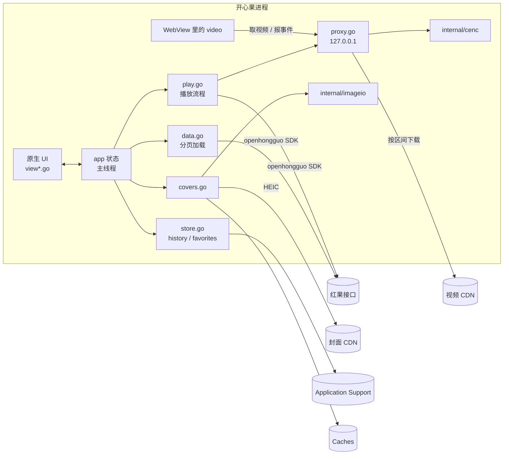

# 架构

这份文档讲开心果的代码是怎么组织的、各部分怎么配合，以及几处不太显然的设计为什么这样做。改代码之前读一遍，能少踩很多坑。

## 总览



开心果是一个 Go 程序，界面用 [MyGo](https://github.com/egoist/mygo) 的原生 UI（`ui` 包）绘制，数据全部来自 [openhongguo](https://github.com/beilunyang/openhongguo) SDK。只有播放视频用到 WebView，而且直到第一次播放才创建。

## 代码地图

| 文件 | 负责什么 |
| --- | --- |
| `main.go` | `app` 结构体（窗口显示的全部状态）、启动、建窗口 |
| `view.go` | 侧栏、路由表、网格页（推荐、排行榜、新剧上线、搜索、热搜、收藏）、卡片 |
| `view_series.go` | 剧集详情：海报、播放和收藏按钮、选季、选集 |
| `view_player.go` | 播放页：WebView、加载和出错的遮罩、右侧选集面板、播放快捷键 |
| `data.go` | `feed` 分页加载、各页的 fetcher、季的编号和排序、首页缓存 |
| `play.go` | 播放流程：解析播放地址、预取下一集、选流、和播放页通信、记录进度 |
| `danmaku.go` | 弹幕：跟着播放进度分段读取、清理和合并重复、交给播放页，以及开关 |
| `proxy.go` | 本地 HTTP 服务：播放页 HTML、边下边解密的视频流、播放事件 |
| `covers.go` | 封面：下载、缩小、磁盘缓存、内存回收 |
| `store.go` | 把一个列表存成 JSON 文件：后台写入、原子替换、退出前刷盘 |
| `history.go` | 观看记录 |
| `favorites.go` | 收藏 |
| `update.go` | 自动更新：MyGo 的更新窗口、「检查更新…」菜单、侧栏的新版本提示 |
| `icons.go` | 侧栏和按钮用的 SVG 图标 |
| `internal/cenc` | 把 CENC 加密的 MP4 按字节区间还原成明文 |
| `internal/imageio` | 通过 purego 调 macOS ImageIO 解码 HEIC 等格式 |
| `e2e.go` | 只在 `-tags e2e` 时编译，打开 MyGo 的自动化接口 |
| `scripts/release.sh` | 签名、公证、附票据，见 [releasing.md](releasing.md) |

## 线程模型

**`app` 里的一切都只属于主线程。** 这是整个代码库最重要的一条约定。

- 视图函数（`a.view` 及其调用的一切）在主线程运行，可以直接读写 `app` 的字段。
- 网络、解码、读写磁盘放在 goroutine 里做，做完用 `a.update(func() { ... })` 把结果交回主线程，同时触发重绘。`update` 是 `Window.Update` 的包装，异步执行。
- 视图会为一个事件重建好几次。视图代码里不能有无条件的副作用；需要的加载要像 `loadMore` 那样先检查 `loading`、`started` 等标记，重复调用也只发一次请求。
- goroutine 里不要捕获 `*ui.Context` 或任何 `ui.Element`。元素在下一次构建前就失效了，详见 `.agents/skills/mygo-maintenance/SKILL.md`。

`store` 是唯一自带 goroutine 的持久化部件：列表本身仍属于主线程，`store` 只接收快照去写盘。

## 列表：`feed`

推荐、排行榜、新剧上线、搜索和收藏页都是同一种东西：一个 `feed`，配一个 `fetcher`。

- `fetcher(ctx, cursor)` 返回一页卡片和下一页的游标。网格滚到距末尾两行时调用 `loadMore` 取下一页。
- 卡片按 ID 去重。搜索接口会重复返回前面的结果，一页里没有新卡片就视为到底，否则网格会无限请求。
- 失败后自动重试，间隔 2、4、8、16 秒；之后显示「重试」按钮。
- 推荐页的第一页缓存在 `Caches/开心果/home.json`。启动时先显示缓存（`stale = true`），新数据到了排在前面、缓存排在后面，网格只增不减，用户不会看到内容跳动。
- 收藏页的 `feed` 没有 fetcher，卡片直接来自 `favorites.cards()`；收藏变动时 `favorites.rev` 加一，页面据此重建网格，并保留滚动位置。

## 播放

剧集是 CENC（AES-CTR，ISO/IEC 23001-7）加密的 HEVC MP4。macOS 的 WebView 播不了加密流，开心果也不想依赖 ffmpeg，所以在本机起一个代理，边下边解密：

1. **解析**（`play.go`）：通过 SDK 取这一集的播放模型（`resolve`）。正在播的时候会预取下一集，切集几乎不用等；CDN 地址一分钟内过期的模型会重新取。
2. **选流**：选最好的一路流。分段的 HLS/DASH 和音视频分离的流目前不支持，直接提示。加密的流再向 SDK 要内容密钥。
3. **登记**（`proxy.add`）：把 CDN 地址、备用地址和密钥登记到代理，换回一个 `http://127.0.0.1:<端口>/<随机前缀>/v/<随机令牌>.mp4`。代理只保留最近 4 路流。
4. **播放**：播放页（`proxy.go` 里的 `playerHTML`）的 `<video>` 请求这个地址。代理第一次收到请求时读文件头，用 `cenc.Open` 找到 `moov`，算出每个样本的位置和 IV；之后每个 Range 请求都从 CDN 取同一区间，原地解密再返回。主地址失败会换备用地址。
5. **回报**：播放页把 `playing`、`progress`、`ended`、`error` 等事件发到 `/event`，`onPlayerEvent` 据此记录进度、读取前方的弹幕、自动连播下一集或下一季。

`internal/cenc` 的关键是**解密不改变任何字节的位置**：样本原地解密，标记加密的盒子改名成同样长度的明文盒子（`encv` → `hvc1`、`sinf` → `free` 等）。所以明文文件的任意区间就是密文文件同一区间解密后的结果，播放器可以随意拖动进度。

代理只监听 `127.0.0.1`，校验 `Host` 头，路径带随机前缀，别的进程猜不到地址。

## 弹幕

红果按播放时间分段下发一集的弹幕（2026-11 实测每段 30 秒），每台匿名设备拿到的是其中精选的一部分。开心果不一次读完整集，而是跟着播放进度读：

- **读取**（`danmaku.go`）：每集一个 `danmakuTrack`，记着读过的时间段（`spans`）和接着往下读的游标。`want(t)` 决定还要不要读、从哪读：播放位置没读过就从这里读（`StartMs`），读过但离末尾不到一分钟就沿游标读下一段，读到片尾就停。开播时读一次，之后每次 `progress` 事件（约 3 秒一次，拖动进度后立即补报）再看一次，同一集同时只有一个请求。读失败隔 10、20 秒再试，连续三次失败这一集就不再读。只保留最近 6 集。
- **清理**：表情代码（`[笑哭]`）换成 emoji，换行和控制字符换成空格，去掉方向控制符这类不可见字符，超过 40 字截断。观众的「+1」会作为同一句话的副本下发，同一句话 20 秒内只留第一条。
- **交给播放页**：`flushDanmaku` 只在已经让播放页播这一集之后，把它还没有的那部分行发过去（`kx.danmaku(集 ID, [[毫秒, 文字], …])`）；播放页也只收当前这一集的。JSON 由 `encoding/json` 生成，会转义 `<`、`>` 和 U+2028/2029，可以直接嵌进脚本。
- **飞行**：播放页把弹幕画在视频画面所在的矩形里（竖屏剧就是中间那一条），只用上部约三成，分 3 到 6 道。一句话占用一道前，要等前一句完全进场，并且算好不会追上它。时间用视频的时钟：暂停、缓冲时停住，倍速时一起变快，拖动进度后清屏、从新位置接着放。迟到 1.5 秒以内的弹幕照样放，更早的跳过。放行用每 100 毫秒一次的定时器而不是 `requestAnimationFrame`，因为系统认为页面被遮住时 rAF 会停；移动本身是 Web Animations。小窗播放时弹幕暂停。
- **开关**：底部播放栏的「弹」按钮和 D 键。播放页的按钮先在页面里切换，再把结果报给 Go；D 键由窗口处理，Go 切换后通知页面。关掉时在数据目录留下 `danmaku-off`，打开时删掉。

## 封面

封面 CDN 只给 HEIC，Go 标准库解不了。`internal/imageio` 通过 [purego](https://github.com/ebitengine/purego) 直接调用 macOS 的 ImageIO（不用 cgo），解码并缩小到 400 像素宽（网格里海报的两倍，适配 Retina），再以 JPEG 存到 `Caches/开心果/covers/`。

- 缓存的键是去掉查询参数的 URL，因为签名参数每次都变。
- 一分钟没出现在任何一帧里的封面会从内存释放，下次从磁盘的 JPEG 重新解码，只要几毫秒。

## 自动更新

自动更新用的是 MyGo 自带的更新器（`mygo.Updater`）和它的原生 UI 更新窗口（`plugins/updater/native`），开心果只做了接线：

- `mygo.json` 的 `updates` 写着公钥和 GitHub 仓库。`mygo build` 拿到私钥时，除了 `.app` 和 `.dmg`，还会生成签名过的更新包 `kai-xin-guo-<版本>-darwin-universal.tar.gz`、相对前几个版本的增量包（`.delta`）和清单 `update-darwin-universal.json`，更新说明取自 `CHANGELOG.md` 里这个版本的一节。
- 应用启动 10 秒后、之后每天一次，读 GitHub 最新 Release 里的清单，版本更新就弹出更新窗口：安装、稍后提醒、跳过这个版本。下载的包用编进应用的公钥校验，签名不对就不装。
- 窗口固定用简体中文，和应用一致。用户选了「稍后提醒」后，侧栏底部仍显示「新版本 x.y.z」，点一下再次打开窗口（`updater.OnChange` 把版本号交给 `app.newVersion`）。
- `mygo dev` 的开发版、没有私钥打出来的包都不会检查更新。

私钥的保管和发版步骤见 [releasing.md](releasing.md)。

## 本地数据

| 文件 | 内容 | 写入方 |
| --- | --- | --- |
| `Application Support/开心果/history.json` | 观看记录，最近的在前，最多 200 部 | `history` |
| `Application Support/开心果/favorites.json` | 收藏，最近收藏的在前 | `favorites` |
| `Application Support/开心果/device.json` | SDK 注册的匿名设备 | openhongguo |
| `Application Support/开心果/window-state.json` | 窗口位置和大小 | MyGo |
| `Application Support/开心果/updater.json` | 上次检查更新的时间、跳过的版本、是否自动安装 | MyGo 的更新插件 |
| `Application Support/开心果/danmaku-off` | 关掉弹幕后留下的标记，删掉就恢复显示 | `setDanmaku` |
| `Caches/开心果/home.json` | 推荐页第一页 | `data.go` |
| `Caches/开心果/covers/` | 封面 JPEG | `covers` |

`history` 和 `favorites` 都建在 `store` 上：

- 主线程改完列表调用 `put`，`store` 复制一份快照交给后台 goroutine。还没来得及写的旧快照直接丢弃，只写最新的。
- 写入先写 `.tmp` 再 `rename`，中途崩溃也不会留下半个文件。
- 文件不存在或读不出来时当作空列表，应用照常打开。
- 应用退出时（`mygo.App.OnQuit`）调用 `flush`，等待最后一次写入落盘。测试也在清理临时目录前调用它。

字段一旦发布就要保持兼容：老版本写的文件新版本必须能读。新增字段用 `omitempty`，不要改已有字段的 JSON 名。

## 测试

```sh
go test ./...            # 全部测试，不需要网络和窗口
go test -race ./...      # 改了跨 goroutine 的状态时跑
go tool mygo vet .       # MyGo 的检查：元素的生命周期、goroutine 捕获
```

- **视图测试**用 `ui.NewTester` 在内存里渲染整个窗口，可以点击、右键、选菜单、推进时间，再检查显示的文字。`main_test.go` 的 `testApp` 造了一个带假数据的 `app`，不联网。新功能至少写一个这样的测试，参考 `favorites_test.go`。
- **`internal/cenc`** 有独立的单元测试。
- **端到端**：`go build -tags e2e` 构建的应用在设置了 `MYGO_AUTOMATION=<socket 路径>` 时监听一个 Unix socket，可以从外部读界面树、点击、截图，协议见 MyGo 的 `docs/plugins/automation.md`。README 里的截图就是这样拍的，见 [CONTRIBUTING.md](../CONTRIBUTING.md#更新截图)。正式构建不包含这个接口。

## 已知限制

- 不支持分段（DASH/HLS）和音视频分离的流。
- 需要登录才能看的集数不能播放，应用不提供登录。
- 只支持 macOS：封面解码依赖 ImageIO，播放依赖系统 WebView。
